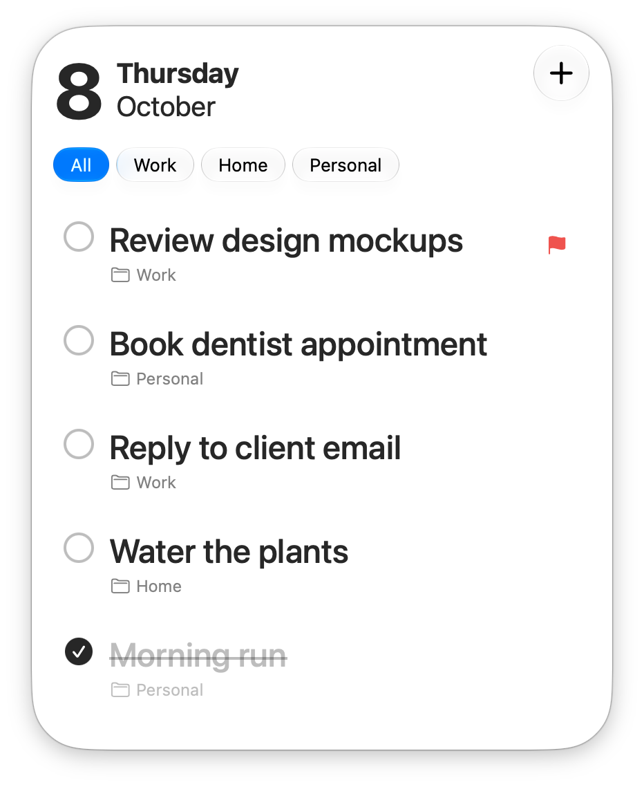

# Notatka

A tiny floating to-do card for macOS. Today's tasks stay in view, quick add works from anywhere with `⌥⌘N`, and your list can follow you to your other Macs through iCloud Drive.

<!-- width = half the @2x pixels, i.e. true size. -->
<p align="center">
  
</p>

## Download

**[Download the latest version](https://github.com/MZZTRMND/Notatka/releases/latest)**

1. Unzip **Notatka-x.x.zip** and move **Notatka.app** to Applications.
2. The app isn't notarized by Apple, so macOS blocks it the first time. Try to open it once, then go to **System Settings → Privacy & Security** and click **Open Anyway**.

Requires macOS 26 or later on an Apple Silicon Mac.

### Coming from StickyToDo

Notatka used to be called StickyToDo. The first time Notatka opens, it brings over your tasks, categories, images and settings, including your iCloud Drive list if sync is on. StickyToDo's own data is left untouched as a backup. Quit StickyToDo before opening Notatka, since both use `⌥⌘N`, and update every Mac you sync, because StickyToDo keeps saving to its old iCloud Drive folder.

## Features

- **Always at hand.** A small floating card with today's date and your tasks
- **Quick add from anywhere.** Press `⌥⌘N` in any app, type, done
- **Categories.** Tabs to filter tasks, and a category picker right in the quick-add field
- **Fresh every day.** Yesterday's completed tasks are cleared away
- **Native look.** Liquid Glass, light and dark mode, adjustable text size
- **Sync between Macs.** Optional iCloud Drive sync keeps the same list on every Mac you use
- **Private.** No account and no servers. Your tasks stay on your Mac, or in your own iCloud Drive if you turn on sync

## Sync with iCloud Drive

Turn on **Sync with iCloud Drive** in Settings to keep your tasks, categories and images in **iCloud Drive › Notatka**. Every Mac signed in to the same Apple Account with the setting on shows the same list, and changes from another Mac appear within seconds.

- **Setting up a new Mac:** install Notatka, turn on the setting, and your list appears. Anything already on that Mac is kept and combined with it.
- **Editing on two Macs:** each task keeps its latest edit, deleted tasks stay deleted, and tasks added on either Mac are all kept.
- **Turning sync off:** the list moves back to this Mac only, including everything added while syncing. Nothing is removed from iCloud Drive.

iCloud Drive must be on in System Settings. With **Optimize Mac Storage** on, an image can take a moment to show while macOS downloads it.

## Tips

- Double-click a task to rename it
- Drag tasks to reorder them, or drop one onto a category tab to move it there
- Right-click a category tab to rename or delete it
- Paste an image while adding or editing a task to attach it
- Drag the card from any empty spot to move it

## Build from Source

Requires Xcode 26 (Swift 6.2).

```bash
swift build
swift run
```

Run the tests with `swift test`.

```text
Notatka/
├── Package.swift
├── Sources/Notatka/
│   ├── AppKit/     # Window, drag, hotkey, menu bar and drop helpers
│   ├── Models/     # TaskItem, TaskCategory
│   ├── Stores/     # Tasks, categories, settings, attachments, iCloud sync
│   ├── Support/    # Theme and small utilities
│   └── Views/      # Main window, quick add, settings
├── Tests/NotatkaTests/
├── Assets/
│   └── AppIcon.svg          # App icon source
└── Scripts/
    ├── make-icon.sh         # Builds the app icon from AppIcon.svg and installs it
    └── make-test-build.sh   # Builds a separate test copy with its own data
```
